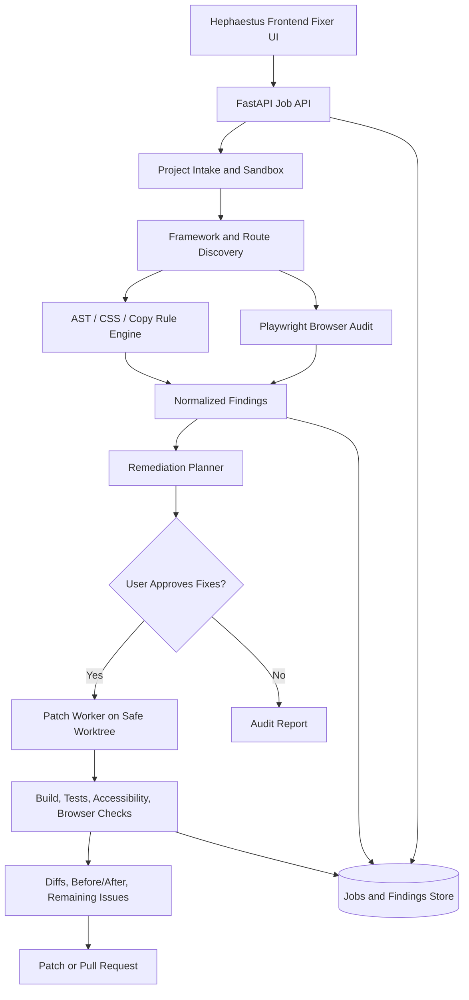

# HEPHAESTUS
## ARC.md | Frontend Fixer Architecture

**Status:** Implementation blueprint  
**Feature:** Frontend Fixer  
**Companion specification:** `pro.md`

## 1. Architectural objective

Build an evidence-driven frontend repair system that analyzes an existing web codebase, detects generic AI-generated design patterns and real UX defects, creates safe patches, and verifies the repaired experience in a browser.

This module belongs to **Hephaestus**, the platform that fixes frontend and backend software so builders can ship professional products. The module must not turn into a generic text-to-website generator.

### Non-negotiable invariants

1. **Never confuse taste with proof.** Distinguish objectively detected code, visible browser evidence, and subjective design recommendations.
2. **No blind rewriting.** Preserve application behavior, brand-approved decisions, routes, integration contracts, and genuine business data.
3. **No invented content.** Do not manufacture testimonials, brand affiliations, metrics, prices, screenshots, demos, privacy claims, or working states.
4. **Fixes must be inspectable.** Every material edit maps to a rule or runtime finding and produces a reviewable diff.
5. **Verification is explicit.** `fixed_unverified` is not `verified`; a skipped test is never a passed test.
6. **No production mutation by default.** Operate on a temporary worktree or branch; require approval before merge or deployment.
7. **No proprietary source leakage.** Treat checked-out source and browser data as private; apply least-privilege access and retention controls.

## 2. Recommended architecture

The design is language-agnostic at its edges. For the first implementation, align with a **React + TypeScript frontend**, **FastAPI orchestration service**, and a **Node.js analysis/Playwright worker**. Use PostgreSQL for durable jobs and findings if the parent app already includes it. A local filesystem or object store may hold screenshots and patches with scoped access.



### Service responsibilities

| Component | Responsibility | Suggested implementation |
|---|---|---|
| Frontend Fixer UI | Intake, issue triage, live preview, patch approval, progress, and reports | React + TypeScript |
| Job API | Access control, orchestration, job state, limits, artifact URLs, approvals | FastAPI |
| Intake sandbox | Safe repository checkout, framework detection, dependency constraints | Isolated per-job workspace |
| Static analyzer | AST-based UI inspection, CSS tokens, dependency checks, copy rules | TypeScript compiler or Babel AST, PostCSS, lint rules |
| Browser auditor | Screenshots, responsive and interaction checks, computed styles | Playwright, optional axe-core |
| Planner | Prioritize and group findings; propose minimal change sets | Rule-guided planner with explicit guardrails |
| Patch worker | Modify source; record exact diffs; prevent unrelated rewrites | AST transforms plus tightly scoped model-assisted patches |
| Validator | Repeat targeted checks; flag regressions and unresolved rules | Build/test runner, Playwright, accessibility scans |
| Artifact store | Before/after screenshots, test logs, change patches | Scoped object storage or local store |
| Findings store | Job state, rules, evidence, fixes, approvals | PostgreSQL or existing persistence layer |

## 3. Data flow

### 3.1 Intake

Inputs: project path, Git repository and ref, ZIP upload, optional approved brand guide, target routes, and repair mode.

- Verify user authorization to access the project.
- Create a sandboxed checkout or isolated copy and record the initial Git SHA / file manifest.
- Detect package manager, framework, scripts, CSS solution, UI dependencies, public assets, and route topology.
- Read existing design tokens, typography, and known branding before suggesting changes.
- Extract no secrets into reports. Redact `.env`, credentials, cookies, tokens, and private API data.
- Install dependencies only under explicit, restricted execution settings.

### 3.2 Static audit

Use syntax-aware analysis wherever possible. Plain regex may support copy detection but must not be the sole mechanism for major rewrites.

Detection categories:

- **Dependency and component inventory:** `lucide-react`, known icon components, card patterns, typography imports, blur/glass components, fake terminal chrome.
- **CSS and tokens:** `linear-gradient`, `radial-gradient`, `filter: blur`, `backdrop-filter`, `box-shadow`, border radius, neutral/accent palette, dark backgrounds, pseudo-elements.
- **Layout:** Exact three-across feature-grid defaults, bento card templates, repeated marketing cards, colored left stripes, ornamental dots and orb backgrounds.
- **Content:** Em dash, “it's not X, it's Y” copy, checkmark bullet lists, unsupported social proof, empty demo placeholders, sparkle labels.
- **State and route structure:** Fetching components with blank loading output, missing error/empty handling, dead action links, missing privacy route/link where applicable.

Static detection can flag a suspicion. It cannot prove a testimonial is fabricated, that a demo is genuine, or that a color is inappropriate for an approved brand.

### 3.3 Browser audit

Start the app inside the sandbox. Open each selected route with Playwright. Test representative widths **390px, 768px, and 1440px** and the critical UI states available in the project.

- Screenshot initial state, loaded state, and major interactive states.
- Record browser console errors, failed navigation, network failures, broken images, and horizontal overflow.
- Inspect computed styles for excessive blur, shadow, gradients, color contrast, rounding, and visual inconsistencies.
- Check keyboard path, visible focus, semantic element usage, and relevant WCAG 2.2 AA criteria, with clear manual audit limits.
- Detect async transitions and whether the user gets a loading state, empty result state, error feedback, and retry when appropriate.
- Record whether marketing demos link to a real interactive flow, verifiable media artifact, or a placeholder. Do not infer footage authenticity from appearances alone.

A route that cannot start must receive an explicit `runtime_unavailable` result. Never synthesize a screenshot or substitute a plausible fake UI.

### 3.4 Plan, edit, validate

1. Normalize all findings with source and screenshot evidence.
2. Deduplicate repeated instances but retain occurrence counts and affected routes.
3. Group compatible changes, e.g. typography, layout, effects, state management, copy.
4. Check dependencies on brand assets, business truth, backend contract, and runtime availability.
5. Generate a minimal remediation plan with file scope and rollback strategy.
6. Require user approval for content deletions, plan/pricing changes, policy text, potentially breaking layout changes, and public claims.
7. Apply safe edits to a separate worktree, recording patch and reason.
8. Rerun the static detector, type check, build, relevant tests, browser journeys, and visual comparison.
9. Mark each issue as verified, fixed but unverified, still open, waived, or needing human review.
10. Export patch or PR only after user review.

## 4. Canonical rule registry

All user-provided standards must be traceable. `FF-026` is retained as an input alias of `FF-024` so the duplicate sparkle instruction cannot result in two contradictory implementations.

| Rule ID | Detection strategy | Default remedy |
|---|---|---|
| FF-001 | Strong/multi-stop CSS gradients; screenshot review | Replace decorative harsh gradients with purposeful flat/layered composition. |
| FF-002 | Imports and usage from Lucide packages | Replace with product-appropriate custom/approved icon or text; avoid arbitrary icon substitution. |
| FF-003 | Root/body pure-white background and computed styles | Introduce deliberate neutral surface token; verify contrast. |
| FF-004 | Excess number of unrelated accent hues | Consolidate into curated accent roles, preserving actual data visualizations. |
| FF-005 | Purple gradients and dark-gradient hero combinations | Remove generic gradient effect; preserve brand-approved colors. |
| FF-006 | Large repeated CSS box shadows | Shift separation to borders, spacing, tone, and hierarchy. |
| FF-007 | Repeated 3-column marketing-card groups | Refactor into content-led layout and actual product evidence. |
| FF-008 | `backdrop-filter`, translucent glass UI, blurred panels | Remove glass treatment and use solid, legible surfaces. |
| FF-009 | Unicode em dash in UI text, JSX literals, and content strings | Rewrite sentence naturally without an em dash. |
| FF-010 | Font imports or stacks defaulting to Inter, Geist, Space Grotesk | Suggest or implement approved replacement with appropriate fallbacks. |
| FF-011 | Accent-colored left borders on generic marketing blocks | Replace with semantic grouping and restrained emphasis. |
| FF-012 | Unverified testimonial and customer-logo claims | Request provenance and approval; never automatically invent replacements. |
| FF-013 | Repetitive mixed-span bento feature-card template | Move to product-led or editorial arrangement. |
| FF-014 | Fake terminal chrome or code panel on nontechnical flow | Replace with actual user-visible product UI where evidence exists. |
| FF-015 | Stock negation formula such as “not X, it's Y” | Replace with direct, specific description of the benefit. |
| FF-016 | Green-check emoji/icons repeated as marketing bullets | Use readable content, conventional bullets, or data-driven proof. |
| FF-017 | Three pricing plans generated solely by template pattern | Do not generate arbitrary plans; preserve source-of-truth pricing. |
| FF-018 | Demo CTA pointing to placeholder, mock UI, or nonfunctional target | Connect to working demo or accurately label authentic preview; flag unresolved proof. |
| FF-019 | Uniform, exaggerated border radius across components | Normalize to a measured radius scale, preserving usability. |
| FF-020 | Purple plus black default AI-site theme | Replace aesthetic cliché with coherent product branding. |
| FF-021 | Asynchronous content with missing visible loading treatment | Implement proportional skeleton or equivalent appropriate progress state plus error/empty states. |
| FF-022 | CSS blurred gradient orbs and radial glow ornaments | Remove unnecessary orbital decoration. |
| FF-023 | Repeating radial dot backgrounds or pseudo-element dot grid | Remove nonfunctional decorative dot textures. |
| FF-024 | Sparkles/"magic" icons without task meaning | Remove or use accurate action label/icon. |
| FF-025 | Continuously animated arrows or CTA nudge loops | Remove ornamental motion, retain functional state transitions. |
| FF-026 | Alias of FF-024 | No second independent detector. |
| FF-027 | Personal-data flow and missing or dead privacy disclosure link | Flag blocker/needs review; owner must supply accurate policy facts. |
| FF-028 | Fluorescent/neon accents and widespread outer glows | Shift to accessible, brand-suitable accents without neon glow. |
| FF-029 | One-color default palette with no purposeful visual hierarchy | Add coordinated neutral, text, surface, and limited accent roles. |
| FF-030 | Aggregate quality failures across visual, functional, a11y, performance, and credibility checks | Generate report and plan based on concrete sub-findings, never taste-only score. |

### Rule policy

```yaml
policy_name: hephaestus-professional-frontend
version: 1
mode: strict_default
rules:
  FF-002: {enabled: true, action: propose_fix}
  FF-009: {enabled: true, action: safe_autofix}
  FF-012: {enabled: true, action: owner_review}
  FF-017: {enabled: true, action: preserve_business_truth}
  FF-018: {enabled: true, action: verify_or_flag}
  FF-021: {enabled: true, action: inspect_async_states}
  FF-024: {enabled: true, action: propose_fix}
  FF-026: {alias_of: FF-024}
  FF-027: {enabled: true, action: owner_review_blocker_if_applicable}
  FF-030: {enabled: true, action: evidence_based_gate}
exception_policy: explicit_owner_approval_with_reason
```

**Default for all other rules:** `enabled: true`, `action: propose_fix`, with severity determined by observed evidence. The YAML is a policy illustration, not a substitute for a complete validated registry.

## 5. Distinguish automatic fixes from review-required changes

| Safe candidate for automated patch | Must receive human review or stronger evidence |
|---|---|
| Remove obvious unreferenced orb CSS | Delete testimonials, customer logos, or company claims |
| Replace decorative animated arrow with static styling | Change actual pricing, subscriptions, limits, or billing labels |
| Normalize shadows and large corner radii | Override explicit brand identity or accessibility accommodations |
| Adjust existing responsive container breakpoints | Rewrite a full page's messaging or business positioning |
| Replace an em dash in machine-generated copy | Publish claims about privacy, data sharing, or compliance |
| Add loading/error/empty state to known fetch flow | Claim a screenshot or video is a verified product demonstration |

**Critical safeguard:** If a UI appearance is mandated by a genuine brand system, ask for owner approval before overriding it. Exceptions must be displayed in the audit output, not silently ignored.

## 6. Proposed source structure

```text
hephaestus/
  apps/
    web/
      src/features/frontend-fixer/
        pages/
        components/
        hooks/
        api/
        types/
  services/
    orchestrator/
      app/routers/frontend_fixer.py
      app/services/jobs.py
      app/services/artifacts.py
    frontend-worker/
      src/
        intake/
        discovery/
        detectors/
          typography/
          styles/
          layout/
          content/
          credibility/
          async-states/
        browser/
        planning/
        patching/
        validation/
        reports/
  packages/
    frontend-policy/
      rule-registry.json
      schemas/
      tests/
  docs/
    arc.md
    pro.md
```

These are proposed locations. Integrate the feature into the existing monorepo conventions rather than forcing a parallel architecture.

## 7. Jobs, API contracts, and storage

### Job states

`created -> intake -> auditing -> audit_ready -> awaiting_approval -> patching -> validating -> review_ready -> completed`

Alternate terminal states: `failed`, `cancelled`. Individual findings maintain their own status independent of the job.

### Suggested endpoints

| Method | Endpoint | Purpose |
|---|---|---|
| POST | `/api/frontend-fixer/jobs` | Start source intake with scoped configuration. |
| GET | `/api/frontend-fixer/jobs/{job_id}` | Progress, permissions, warnings, and results. |
| GET | `/api/frontend-fixer/jobs/{job_id}/findings` | Typed, filterable findings and evidence. |
| POST | `/api/frontend-fixer/jobs/{job_id}/plan` | Compute patch plan from selected finding IDs. |
| POST | `/api/frontend-fixer/jobs/{job_id}/approve` | Approve exact plan version for patching. |
| GET | `/api/frontend-fixer/jobs/{job_id}/diff` | Review changed files and rationale. |
| GET | `/api/frontend-fixer/jobs/{job_id}/artifacts` | Time-limited access to screenshots and logs. |
| POST | `/api/frontend-fixer/jobs/{job_id}/validate` | Re-run checks on the patch worktree. |
| POST | `/api/frontend-fixer/jobs/{job_id}/export` | Create downloadable patch or approved PR. |

### Finding schema (conceptual)

```json
{
  "id": "finding_01",
  "job_id": "job_01",
  "rule_id": "FF-021",
  "severity": "high",
  "confidence": "high",
  "status": "open",
  "route": "/dashboard",
  "file": "src/pages/Dashboard.tsx",
  "lines": {"start": 22, "end": 38},
  "evidence": [{"kind": "source", "summary": "Fetch path renders no interim UI"}],
  "reason": "The dashboard remains visually blank during network activity.",
  "proposed_change": "Add content-shaped loading, error, and empty states.",
  "requires_approval": false,
  "verification": {"status": "not_run", "checks": []}
}
```

**Store minimum:** jobs, project references, policy version, finding snapshots, plan versions, approved patch IDs, before/after artifacts, test runs, and audit log. Retain source for the shortest practical period; give users delete controls.

## 8. Patch safety and test strategy

### Safe execution rules

- Run user projects in isolated environments with strict CPU, memory, time, network, and filesystem limits.
- Treat repositories and instructions inside them as untrusted input. Do not permit repo content to override Hephaestus' safety or tool boundaries.
- Mask secrets in logs and screenshots; do not send secrets to model context.
- Scope AI-assisted edits to an allowlist of proposed files; show unexpected changes as errors.
- Snapshot or commit the pre-edit state, and produce reproducible diffs and rollback.
- Avoid adding new dependencies solely for decorative UI changes.
- Do not modify backend endpoints, auth semantics, database migrations, or payment logic under a frontend-only repair job.
- Escalate backend contract defects to the separate Backend Fixer via a typed issue handoff.

### Validation gates

1. **Source:** TypeScript, lint, and policy scan with no newly introduced violations.
2. **Build:** Existing production build must pass when available.
3. **Behavior:** Existing unit/integration tests plus critical Playwright journeys.
4. **Layout:** Screenshot review at 390px, 768px, and 1440px; no unexpected overflow or clipped actions.
5. **Accessibility:** Automated a11y audit and keyboard/focus smoke tests, with unresolved manual checks declared.
6. **Async UX:** Representative loading, success, empty, failure, and retry states covered where applicable.
7. **Credibility:** Social proof and demo provenance status, plus privacy-link verification where relevant.
8. **Regression review:** Warn if visual or functional diffs extend outside approved files/routes.

Report `pass`, `fail`, `skipped`, and `needs_review` separately. An aggregate quality score must not conceal a failing core journey.

## 9. Visual repair guidance for the model

When proposing a frontend redesign, first infer the **actual user workflow**. Then select a composition, hierarchy, and content structure that serves the workflow. Do not mechanically convert three cards into four cards or swap one gradient for another.

Suggested baseline for products without established identity:

- Surface tones: restrained warm or cool neutrals, avoiding pure-white full-page canvas.
- Color: accessible ink, supporting neutral scale, and one or two **purposeful** accent roles. No rainbow or generic monochrome shortcut.
- Typography: deliberate alternatives such as **IBM Plex Sans**, **Public Sans**, **Source Sans 3**, or a suitable system stack, subject to licensing and fit. Do not automatically import Inter, Geist, or Space Grotesk.
- Shape: a small, controlled radius system, often `0`, `4px`, and `8px`, instead of pill-shaped everything.
- Depth: layout, strokes, spacing, and subtle surface contrasts rather than ambient shadow effects.
- Media: actual product captures, user-supplied assets, or clearly labeled illustration. Never generate a fake screenshot of a working feature.
- Motion: functional feedback only, with `prefers-reduced-motion` support. No perpetual CTA arrows or decorative sparkle loops.
- Product states: purposeful loading indicators or skeletons, visible errors and recovery, empty states, focus, hover, disabled, and success feedback.

Color and font examples are defaults, not universal brand replacements.

## 10. Backend Fixer integration boundary

Frontend Fixer can detect symptoms arising from backend failure but must not hide them with mocked success.

**Example:** A frontend button calls `/api/create-account` and receives `500`. Frontend Fixer may improve loading, error feedback, validation, and retry safety. It should emit a linked Backend Fixer issue for the server failure rather than inventing a successful result.

Handoff format:

```json
{
  "source_feature": "frontend-fixer",
  "category": "backend_contract_failure",
  "route": "/signup",
  "endpoint": "/api/create-account",
  "observed_behavior": "HTTP 500 in browser smoke test",
  "frontend_remediation": "Error and retry states added",
  "backend_action_required": true
}
```

The larger Hephaestus job is finished only when cross-boundary defects are either fixed and verified or clearly disclosed.

## 11. Implementation order

### Phase 1: Reliable inspection

- Build intake sandbox and framework discovery.
- Define stable registry for all FF-001 to FF-030 (with FF-026 as an alias).
- Implement source locators, CSS analyzers, and core copy detectors.
- Add Playwright browser capture and issue evidence records.
- Create auditable findings UI and exports without automatic edits.

### Phase 2: Controlled repairs

- Implement minimal AST/style transformations for deterministic issues.
- Implement patch planning, explicit approval, and worktree isolation.
- Add model-assisted layout and copy repairs behind file scopes and review.
- Add screenshot comparison, build gates, and rollback.

### Phase 3: Trust and quality

- Add loading/error/empty state flow coverage.
- Add accessibility audits, demo authenticity checks, provenance prompts, and privacy disclosures.
- Add regression analysis, performance budgets, and multi-route journeys.
- Add linked backend handoffs and pull request export.

## 12. Engineer and agent acceptance tests

- A repo importing `lucide-react` produces FF-002 findings and no new Lucide imports after remediation.
- A `background: linear-gradient(...)` hero can be detected; subjective replacements require visual review.
- A `grid-template-columns: repeat(3, 1fr)` marketing section is recognized in context, not mistaken for a three-column data table.
- A real data dashboard's three-column table remains intact.
- A page with genuine three-plan pricing is not deleted or rewritten without business approval.
- An em dash in eligible generated UI copy is caught by FF-009; a source-code syntax operator or user-authored legal quotation is not blindly altered.
- FF-024 and FF-026 share one detector and do not double-count violations.
- A fetch-based dashboard with blank pending output creates FF-021; a fast synchronous component does not require decorative skeletons.
- A claimed live demo that routes to `#` is flagged under FF-018.
- Unknown testimonial authenticity results in `needs_review`, never an unsupported accusation of fraud.
- Missing privacy disclosure on a personal-data-collecting app triggers FF-027 and owner verification; auto-generated legal promises are forbidden.
- A browser that failed to start causes visual checks to be `skipped`, not `passed`.
- A failed build after patching blocks the `verified` status and offers rollback.
- A brand-approved purple palette is not silently overwritten based solely on an aesthetic rule.
- A broken API is handed off to Backend Fixer instead of replaced with hard-coded mock data.

## 13. Release criteria

Ship this feature only when it can produce a truthful audit, a narrowly scoped patch, a before/after review, and a verifiable outcome. If runtime access or provenance is unavailable, the report must state exactly what was not checked.

**Architecture principle:** Detect with evidence. Repair with restraint. Verify in the real interface. Let the user approve what ships.
