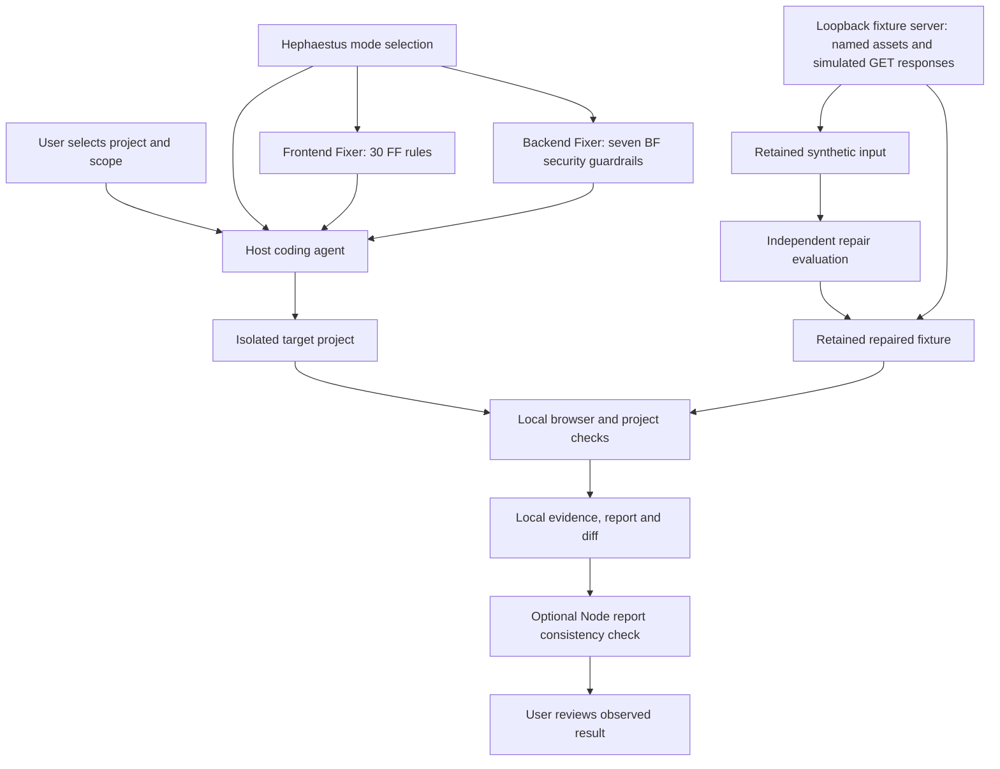

# Frontend skill implementation

The owner's [ARC](arc.md) and [product specification](pro.md) are preserved as supplied. Their 30-rule frontend policy is implemented in `skills/hephaestus/policy/frontend-policy.json`. The user's direct request selects an **installable agent skill**, so the hosted app architecture is not part of this release.

| Supplied app concept | Skill implementation |
| --- | --- |
| Project intake UI | Agent inspects the user's selected local checkout and task scope |
| Audit and findings workspace | Source/browser evidence, findings report and user discussion |
| Remediation planner | Agent proposes a concrete file-scoped repair plan |
| Patch worker | Host agent edits an isolated checkout within the agreed scope |
| Validation and preview | Existing project commands, host browser tools, captures and report checker |
| Export | Reviewable Git diff or patch; publication only when authorized |
| FastAPI, job database, React dashboard, upload/clone service | Deferred; no server or hosted UI is installed |

The skill delegates source understanding and repairs to the host model and tools. It does not pretend that a regex script automatically detects all 30 standards. Each registry entry contains the detection guidance and required behavior for the agent. React and Next.js are the primary workflows; source-level review of other frameworks uses the same policy without claiming identical runtime coverage.

The report consistency checker uses Node's standard library to reject status, alias, scope and completion contradictions. Frontend-capable packages also include pinned Taste source tools for design directions, source lint and real-browser inspection. These tools do not attest that check results or approvals are authentic. No model API, account system, database, new frontend framework or custom installer is needed.

## Implemented architecture

The host agent is the execution boundary: Hephaestus does not supply a separate model or service. Source, browser data and reports remain local unless publication is explicitly authorized. The report helper reads JSON only. The optional evaluation server binds to `127.0.0.1`, serves an explicit asset list and synthetic read-only responses, and has no persistence, credentials or external API. It remains frontend test infrastructure. The new [Backend Fixer workflow](../skills/hephaestus/references/backend.md) operates on real server code in the selected project; no hosted product API is installed.

Frontend and backend reports use separate `target` values and policy namespaces. Missing `target` retains the old frontend behavior. Frontend verification still requires route-matched 390/768/1440 browser observations. Backend verification requires seven named security gates and behavior tests; skipped gates block completion. The checker cannot establish whether reported observations are authentic or protect a running application by itself.

## Taste contribution

The [Taste integration](../skills/hephaestus/references/taste.md) now bundles the pinned source tools, JSON libraries, references and CSS/JS foundations from Leonxlnx/taste-skill at `6010f91a9935f1c167dfc500fb1a475681892e6b`, preserving its MIT license. Hephaestus uses the owner's stricter policy and explicit brand decisions. Browser inspection disables upstream media/motion quotas; both browser helpers reject filesystem targets to avoid source-tree exposure. Raw Taste diagnostics remain distinct from evidence-backed FF findings. No media/font files or missing scene catalogue are invented or bundled.

Three actual skill directories provide the router and direct frontend/backend picker entries. The repository's `scripts/package-skills.mjs` materializes standalone entries from the canonical package; an isolated regeneration test detects drift. Frontend-capable entries include Taste, while Backend Fixer does not carry its runtime. Each entry has its own metadata, logo, policies and report helper.

## Verification scope

Parser tests establish metadata invariants, not aesthetic outcomes. Behavioral eval prompts cover scope, business facts, async state handling, backend handoff and unavailable browsers. Use real project checks and screenshots for an actual repair. Do not describe this release as a standalone autonomous scanner or as a production-readiness certification.

The [runnable evaluation](../evals/results/runnable-repair/README.md) now records one independently repaired native-web fixture, 45 passing browser assertions and their limits. Broader framework and host support remains unverified.
